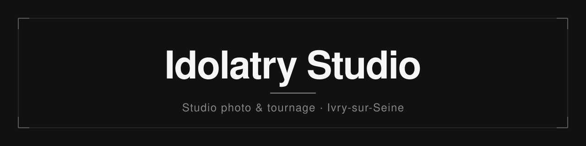
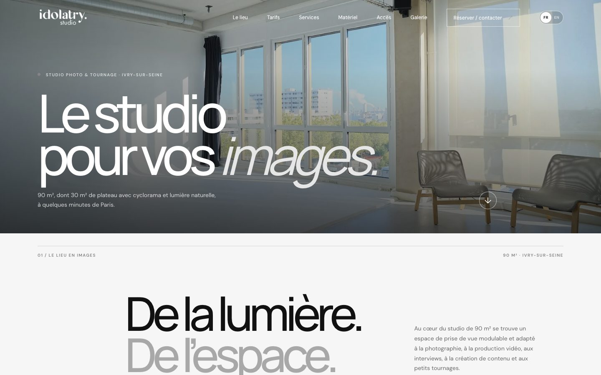
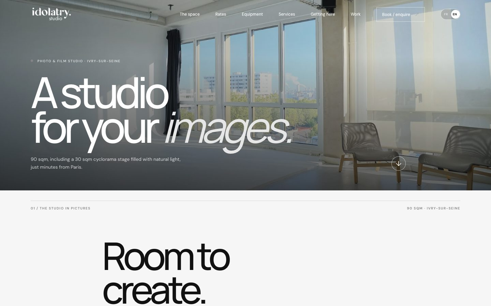
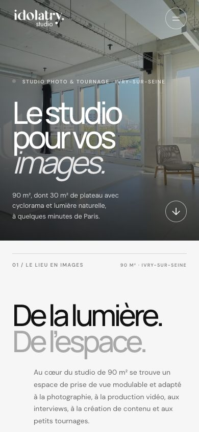

<div align="center">



# Idolatry Studio

**Le site vitrine du studio photo et tournage Idolatry, à Ivry-sur-Seine.**
<br />
90 m² dont 30 m² de plateau avec cyclorama, lumière naturelle, à quelques minutes de Paris.

<br />

[](https://studio.idolatry.tv/)
[](https://studio.idolatry.tv/en/)
[](https://studio.idolatry.tv/#tarifs)
[](#d%C3%A9veloppement-local)
[](#publication)
[](#droits)

<br />

[Voir le site](https://studio.idolatry.tv/) · [English version](https://studio.idolatry.tv/en/) · [Structure](#structure) · [Développement local](#développement-local) · [Publication](#publication)

<br />



</div>

<br />

## Ce que présente le site

<table>
  <tr>
    <td width="33%" valign="top">
      <h4>🏠 Le lieu</h4>
      Un studio de 90 m² dont 30 m² de plateau avec cyclorama et lumière naturelle, un salon et une cuisine. Une galerie photo avec visionneuse plein écran, et le plan du studio.
    </td>
    <td width="33%" valign="top">
      <h4>💶 Les tarifs</h4>
      Location à la journée, prix HT : studio seul à 650 €, studio avec kit lumière (LED ou flash) à 780 €. En option : remise en blanc du cyclorama ou couleur personnalisée sur devis.
    </td>
    <td width="33%" valign="top">
      <h4>🛎️ Les services</h4>
      Ce qui est inclus dans la location (wifi, cuisine équipée, climatisation, portants, assistant plateau…) et les prestations à la carte : photographe, vidéaste, catering, post-production, parking.
    </td>
  </tr>
  <tr>
    <td width="33%" valign="top">
      <h4>💡 Le matériel</h4>
      Le catalogue des équipements en option, classé en sources continues, flash, accessoires et grip, avec marques, quantités et prix HT. Chaque catégorie se déplie.
    </td>
    <td width="33%" valign="top">
      <h4>✉️ Le contact</h4>
      Un formulaire qui prépare la demande (nom, e-mail, type de demande, date, projet) et ouvre la messagerie du visiteur pour qu'il relise et envoie le message.
    </td>
    <td width="33%" valign="top">
      <h4>📍 L'accès</h4>
      L'adresse, les horaires, une carte intégrée et un lien vers le calcul d'itinéraire. Le site présente aussi quelques projets tournés au studio.
    </td>
  </tr>
</table>

<br />

## Aperçu

<table>
  <tr>
    <td width="66%" valign="top">
      
      <br />
      <sub>Version anglaise, disponible sous <code>/en/</code></sub>
    </td>
    <td width="34%" valign="top">
      
      <br />
      <sub>Affichage mobile (390 px)</sub>
    </td>
  </tr>
</table>

<br />

## Fonctionnalités

- **Deux langues** : français à la racine, anglais sous `/en/`, avec un sélecteur FR / EN dans l'en-tête.
- **Galerie avec visionneuse** : ouverture en plein écran, navigation précédent / suivant, fermeture au clic ou au clavier.
- **Navigation** : menu à ancres, menu repliable sur mobile, bouton de retour en haut de page.
- **Matériel en accordéons** : les catégories d'équipement se déplient à la demande.
- **Formulaire de contact** : prépare un e-mail pré-rempli, sans serveur ni stockage des données.
- **Bandeau de consentement** : Google Analytics et Google Ads sont chargés en mode Consentement v2, refusés par défaut et accordés seulement après acceptation du visiteur.
- **Mentions légales** : une page en français et une en anglais.
- **Accessibilité et confort** : textes alternatifs, libellés ARIA, animations d'apparition désactivées si le visiteur préfère réduire les animations.

<details>
<summary><strong>Référencement (SEO)</strong></summary>

<br />

- Balises `title`, `description`, `canonical` et métadonnées Open Graph / Twitter Card pour chaque langue.
- Données structurées Schema.org : `WebSite` et `PhotographyStudio` (adresse, zone de service, fourchette de prix, horaires).
- Balises `hreflang` `fr`, `en` et `x-default`, reprises dans le `sitemap.xml`.
- `robots.txt` qui autorise l'exploration et indique l'emplacement du sitemap.
- Images servies en WebP à plusieurs tailles (`srcset`).

</details>

<details>
<summary><strong>Design</strong></summary>

<br />

Le site reprend la charte d'Idolatry : noir `#111111`, blanc cassé `#F6F6F6` et gris `#858585`, définis comme variables CSS dans `styles.css`.

Les titres sont en **Manrope** et le texte courant en **DM Sans**. Les deux polices sont hébergées dans le dépôt (dossier `fonts/`), sans appel à un service externe de polices.

</details>

<br />

## Structure

```text
.
├── index.html               Version française
├── en/
│   ├── index.html           Version anglaise
│   └── mentions-legales.html
├── mentions-legales.html    Mentions légales (français)
├── styles.css               Styles et mise en page
├── script.js                Menu, visionneuse, formulaire, consentement
├── fonts/                   Polices Manrope et DM Sans (woff2) + fonts.css
├── media/                   Photographies du studio, plan, visuels de projets
├── favicon.svg              Icônes du site (+ favicon-48, -192 et -512 en PNG)
├── logo-idolatry-studio.png Logo
├── sitemap.xml              Plan du site avec hreflang
├── robots.txt               Consignes d'exploration
├── CNAME                    Domaine personnalisé pour GitHub Pages
└── docs/                    Bannière et captures de ce README
```

> [!NOTE]
> Le site est entièrement statique : pas de compilation, pas de dépendances à installer. Ce qui est dans le dépôt est ce qui est publié.

<br />

## Développement local

Il suffit de servir le dossier avec un serveur HTTP simple, depuis la racine du dépôt :

```bash
python3 -m http.server 8000
```

Le site est alors disponible sur [http://localhost:8000](http://localhost:8000), et la version anglaise sur [http://localhost:8000/en/](http://localhost:8000/en/).

Un serveur est préférable à l'ouverture directe du fichier `index.html` : les chemins et les médias se comportent comme en production.

<br />

## Publication

Le site est publié par **GitHub Pages** depuis la branche `main`. Le domaine personnalisé `studio.idolatry.tv` est défini dans le fichier `CNAME`.

Chaque changement poussé sur `main` déclenche un nouveau déploiement.

> [!NOTE]
> Le dossier `docs/` ne contient que la bannière et les captures de ce README. Il n'a aucun rôle dans le site publié.

<br />

## Droits

Les textes, photographies et logos du site sont © Idolatry, tous droits réservés. Aucune licence d'utilisation n'est accordée : toute reproduction ou réutilisation nécessite l'accord préalable d'Idolatry.

<br />

<div align="center">

**[studio.idolatry.tv](https://studio.idolatry.tv/)**
<br />
<sub>Idolatry Studio · Ivry-sur-Seine</sub>

</div>
